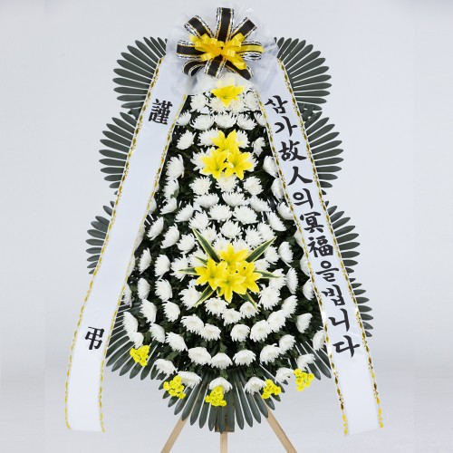
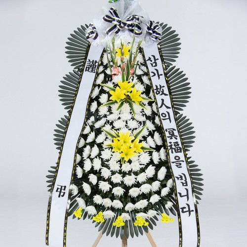
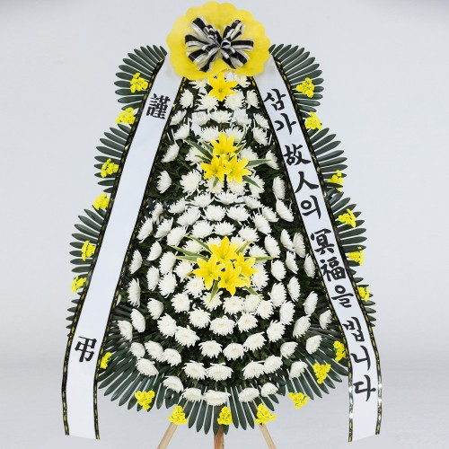
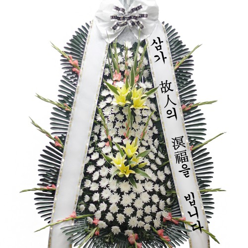

# 여수전남병원장례식장 근조화환 상품과 주문 안내

여수전남병원장례식장에 조의를 전하실 수 있도록, 꽃이랑의 근조화환 네 상품과 주문 상담 방법을 안내합니다. 부고를 받은 뒤 화환을 처음 알아보시는 분께는 상품 이름이나 리본 문구부터 낯설 수 있습니다. 정해 둔 예산이 있다면 그 안에서 선택할 상품을, 문구가 고민이라면 전하고 싶은 뜻에 맞는 표현을 상담해 드립니다.

기본가격은 59,000원부터 149,000원까지입니다. 아래 사진과 가격으로 상품을 살펴보시거나, 꽃이랑 1844-0644에 문의해 주세요. 고인을 추모하고 유가족께 위로를 전하는 자리에 맞춰 차분히 준비하실 수 있도록 주문 상담을 돕겠습니다.

## 예산과 사진으로 비교하는 네 가지 근조화환

5만 원대의 근조 3단 화환 B201은 기본가격 59,000원입니다. 샘플에는 흰 꽃 사이로 노란 꽃이 배치되어 있습니다. 7만 원대의 근조 고급 3단 화환 B203은 79,000원으로, 검은 테두리 리본과 상단의 분홍빛 꽃이 보이는 샘플을 함께 제시합니다. 두 상품은 각각의 상세 사진으로 전체 구성을 비교하실 수 있습니다.

10만 원대에서는 근조 특대 3단 화환 B205 109,000원과 근조 특특대 3단 화환 B060 149,000원이 있습니다. B205의 샘플은 위쪽 노란 장식과 흰 꽃 중심 구성이, B060의 샘플은 넓은 흰 리본 사이의 흰색·노란색·분홍빛 꽃이 눈에 띕니다. 상품명에 붙은 고급·특대·특특대는 공식몰의 구분이며, 여기서는 실제 사진과 기본가격을 함께 안내합니다.

개인적으로 보내시는지, 회사나 모임에서 마련한 예산인지에 따라 편안한 범위가 다를 수 있습니다. 꽃이랑은 정해 두신 금액과 선호하는 모습을 바탕으로 상품 선택을 상담해 드립니다.

<!-- PRODUCT_CARDS_START -->
### 근조 3단 화환 B201

상품 기본가격 59,000원

[B201 상세 사진과 상품 보기](https://fwith.co.kr/shop/item.php?it_id=B201)

### 근조 고급 3단 화환 B203

상품 기본가격 79,000원

[B203 상세 사진과 상품 보기](https://fwith.co.kr/shop/item.php?it_id=B203)

### 근조 특대 3단 화환 B205

상품 기본가격 109,000원

[B205 상세 사진과 상품 보기](https://fwith.co.kr/shop/item.php?it_id=B205)

### 근조 특특대 3단 화환 B060

상품 기본가격 149,000원

[B060 상세 사진과 상품 보기](https://fwith.co.kr/shop/item.php?it_id=B060)
<!-- PRODUCT_CARDS_END -->

## 상품값과 함께 살펴볼 총예산

표시된 금액은 화환의 기본가격이며, 배송지에 따라 추가 배송비가 발생할 수 있습니다. 총예산을 정해 두셨다면 배송비까지 포함한 금액을 말씀해 주세요. 선택하신 상품과 배송지를 기준으로 최종금액을 상담해 드립니다.

예를 들어 7만 원 안에서 준비하고 싶으시다면 B201의 기본가격을 출발점으로 삼을 수 있습니다. 다만 59,000원이 그 주문의 결제총액이라는 뜻은 아니므로, 최종금액까지 예산에 맞는지 상담한 뒤 상품을 결정하시면 됩니다.

## 여수전남병원장례식장 배송지 안내

여수시의 2025-12-31 기준 장례식장 현황에 실린 주소는 여수시 광무1길 28-6, 광무동입니다. 병원 공식 홈페이지에 표시된 주소인 좌수영로 49와 구분되므로, 주문에는 여수전남병원장례식장이라는 이름과 해당 빈소를 함께 담습니다. 이 안내는 광무동의 여수전남병원장례식장을 대상으로 합니다.

화환 수령 위치나 반입 조건은 장례식장 안내에 따릅니다. 전달을 원하시는 시각이 발인 전이라면 희망 날짜·시간과 함께 발인 시각을 알려주세요. 실제 배송 가능 여부는 접수 시점과 배송지를 바탕으로 주문 상담에서 안내해 드립니다. 희망 시간을 남기는 것만으로 도착 일정이 확정되는 것은 아닙니다.

## 한 번의 상담에 담으면 좋은 주문 내용

장례식장과 빈소, 상주 또는 받는 분, 전달 희망 날짜·시간, 상품번호나 전체 예산, 리본에 넣을 말과 보내는 분 표기, 주문자 연락처를 한 번에 말씀해 주시면 됩니다. 발인 일정이나 수령에 관한 별도 안내를 받으셨다면 그 내용도 함께 전해 주세요.

아직 모르는 항목이 있으면 아시는 내용부터 말씀하셔도 괜찮습니다. 상품과 문구를 고르는 상담부터 시작할 수 있습니다. 일정이 급한 경우에는 희망 시각을 먼저 알려주시면, 그 일정으로 주문을 진행할 수 있는지 상담하는 데 도움이 됩니다.

리본 문구로는 ‘삼가 고인의 명복을 빕니다’ 또는 ‘깊은 애도를 표합니다’를 생각하실 수 있습니다. 종교적 표현을 피하고 싶다면 후자처럼 애도의 뜻을 짧게 담는 방법도 있습니다. 유가족의 뜻에 맞춰 정해 둔 문구가 있다면 그 문장을 상담에 전해 주세요.

보내는 분 표기는 받는 분이 누구의 조의인지 알 수 있는 이름이면 좋습니다. 개인 이름으로 보내시거나 회사의 정식 명칭과 직함을 함께 적으실 수 있습니다. 글을 길게 늘리기보다 전할 문구와 발송인 표기를 나누어 생각하시면 준비가 한결 간단합니다.

## 주문 후 내용이 달라졌을 때

빈소·일정·리본을 바꾸거나 주문을 취소해야 한다면, 기존 주문 내용과 바뀐 사항을 꽃이랑에 알려주세요. 제작·배송 진행 상태에 따른 처리 가능 범위와 적용 조건을 개별 주문 상담에서 안내해 드립니다. 이미 진행 중인 주문은 변경 요청이 반영되는지와 비용 처리를 함께 상담하시는 편이 좋습니다.

## 자주 묻는 질문

### 사진 속 꽃은 모두 생화인가요?

꽃이랑의 화환은 생화와 조화를 혼합해 사용합니다. 사진은 상품 샘플이며 계절과 지역에 따라 소재와 형태가 달라질 수 있습니다. 사진에 있는 특정 꽃이나 색이 중요하시다면 원하시는 부분을 상품 상담에 말씀해 주세요.

### 리본에 한자를 꼭 넣어야 하나요?

추모 문구는 앞의 예시처럼 한글로 정중하게 표현하셔도 좋습니다. 회사나 모임에서 정해 둔 한자 문구가 있다면 원하는 글자를 그대로 전해 주세요. 한글·한자 중 어느 쪽이든 뜻을 분명히 담는 문구를 상담해 드립니다.

### 장례가 끝나면 화환도 수거해 주나요?

꽃이랑은 화환을 별도로 수거하지 않습니다. 장례식장 안에서의 정리와 처리 방식은 시설의 운영 안내에 따릅니다.

[여수전남병원장례식장 근조화환 상담 · 1844-0644](tel:18440644)

## 출처 및 확인 정보

- 장례식장 주소: [여수시 2026 업무계획](https://www.yeosu.go.kr/contents/88/2026_plan1.pdf) 실제 472쪽·인쇄 468쪽, 2025-12-31 기준 표. 자료 확인 2026-10-14.
- 병원 홈페이지 주소: [여수전남병원 공식 홈페이지](https://www.yscnhosp.com/), 2026-10-14 확인.
- 상품명·기본가격·샘플 사진·상품 안내: 꽃이랑 공식 B201·B203·B205·B060 상세 및 공통 안내, 2026-10-13 확인. 상품별 버튼은 각 상세 페이지로 연결됩니다.
